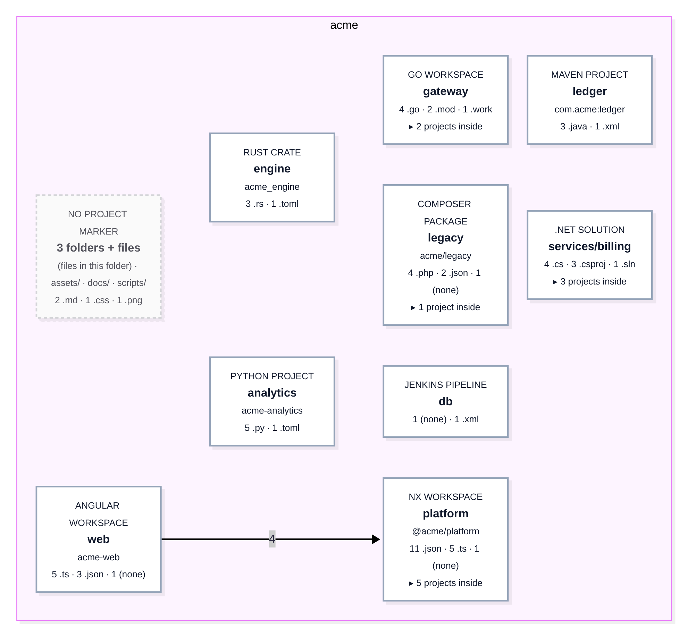
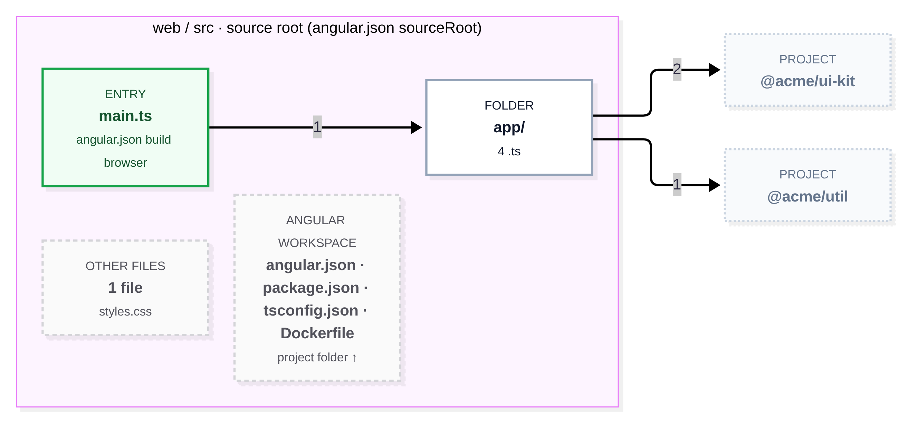
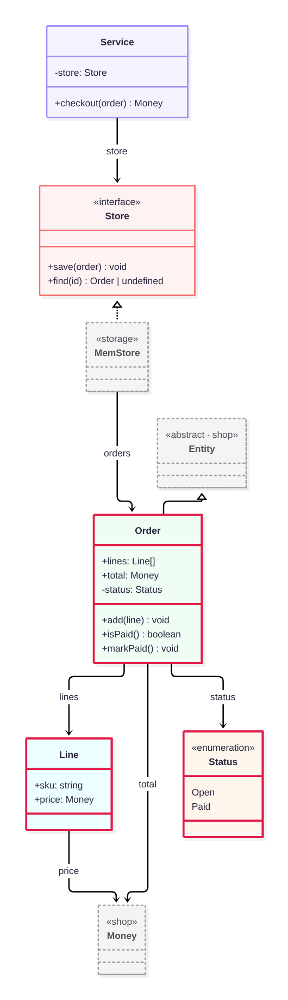

# Mermaid MMD Tools

[](https://marketplace.visualstudio.com/items?itemName=d8aware.vscode-mermaid-extension)
[](https://marketplace.visualstudio.com/items?itemName=d8aware.vscode-mermaid-extension)
[](https://marketplace.visualstudio.com/items?itemName=d8aware.vscode-mermaid-extension)
[](https://ko-fi.com/d8aware)

**See a codebase as diagrams, from the whole repository down to a single class, in any language.**

Right-click a folder to see the projects in it and how they depend on each
other. Click a project to see its code folder by folder, starting from its
entry points. Click a file to explore its classes one step at a time. The
diagrams are Mermaid, so any view can be saved as a `.mmd` file and previewed
here, in Markdown or on GitHub.

Every box and arrow comes from a written rule applied to your files or to
your language extension's answers. Nothing is guessed, so the same code always
draws the same picture, and hovering a box tells you which rule drew it.



## What you can do

| | Right-click | You get |
|---|---|---|
| **Explore a repository** | a folder → **Explore From Here** | The projects in it, labelled by kind and name, with arrows for the dependencies they declare. Click to go deeper. |
| **Explore a project** | click a project | Its code a folder at a time: subfolders, files, entry points, imports between them, and the other projects they use. |
| **Explore classes** | a source file → **Explore Classes From Here**, or click a file | The file's classes in full. The classes around them (supertypes, subtypes, what they use, what uses them) are dashed boxes you click to bring in. A barrel file (`public-api.ts`, `__init__.py`, `mod.rs`) shows the classes it re-exports. |
| **Draw a folder's classes** | a folder → **Generate Class Diagram** (TypeScript) | A `.classes.mmd` class diagram of everything in the folder. |
| **Draw one file's neighbourhood** | a file → **Generate Focused Class Diagram** (TypeScript) | The file's classes with every class connected to them, anywhere in the project. |
| **Preview Mermaid** | a `.mmd` or `.mermaid` file → **View Diagram** | A pan-and-zoom preview that updates as you type. |

### Explore a repository



**Explore From Here** finds projects by their marker files (`package.json`,
`angular.json`, `nx.json`, `*.sln`, `*.csproj`, `go.mod`, `pyproject.toml`,
`pom.xml`, `Cargo.toml`, `composer.json`, `Dockerfile` and more). Arrows come
only from what the projects declare: package and module imports, `tsconfig`
path aliases, dependencies in `package.json`, `go.mod`, `pyproject.toml`,
`pom.xml`, `Cargo.toml` and `composer.json`, and .NET `<ProjectReference>`.

Click a project and it opens at its declared source root (`angular.json`
`sourceRoot`, Maven's `src/main/java`, Composer's `psr-4` folder). Entry
points are marked: a build target's `main`, `package.json` `bin`, Python
`[project.scripts]`, Cargo binaries, or what the language itself marks as
a program start (`package main`, `static void Main`, top-level statements,
`if __name__ == "__main__"`, `fn main`). Arrows between folders and files
are the imports between them.

Breadcrumb, **Back**, **Start over** and **Save view** work across every
level, from the repository down to classes. Each step keeps you oriented: a
badge names the level (Projects, Code, Classes); going deeper zooms into the
box you clicked and going back up rings the box you came from; when a class
view grows, the boxes you had glide to their new places, and the class you
clicked ("you clicked") and the one before it ("came from") are ringed.

### Explore classes



The file's classes are shown in full and outlined. Classes one step away are
dashed: click one to bring it in with its own neighbours, click a full class
to open its source, and use **+N more** when there are many.

## Languages

TypeScript is analysed by the extension itself. Every other language is
answered by the language extension you already have installed, so the
explorer works wherever VS Code understands the code:

| Language | Explore From Here | Explore Classes From Here | Answered by |
|---|---|---|---|
| TypeScript / JavaScript | npm, Angular, Nx, tsconfig aliases | ✓ | the extension's own analysis |
| Go | Go workspaces and modules | ✓ | Go (`golang.go`) |
| C# | .NET solutions and projects | ✓ | C# (`ms-dotnettools.csharp`) |
| PHP | Composer | ✓ | Intelephense |
| Python | `pyproject.toml`, `requirements.txt` | ✓ | Python (`ms-python.python`, Pylance) |
| Java / Kotlin | Maven (Gradle recognised) | ✓ | Java (`redhat.java`) |
| Rust | Cargo | ✓ | rust-analyzer |
| Swift, Scala, Dart, C/C++, Ruby and others | marker files | ✓ where the extension answers | their language extension |

Language extensions answer different questions. Where one has no type
hierarchy, supertypes come from the class declaration (`class A extends B`,
`impl Store for MemStore`), and the panel says so. To see what your setup
answers for a file, run **Mermaid: Check Explorer Language Support**.

Languages plug in through small, fixed rule files called packs: see
[how language support works](docs/language-packs.md) to add one.

## Previewing Mermaid files

Open a `.mmd` or `.mermaid` file and click the diagram icon in the editor
title bar. Diagrams render with Mermaid 12 (ELK layout, modern look). To keep
the classic Mermaid 11 style for a diagram, start it with:

```
---
config:
  layout: dagre
  look: classic
  theme: default
---
```

By default each preview opens its own panel. Turn on
`vscode-mermaid-extension.useSinglePreview` for one panel that follows the
active file, like the Markdown preview ([preview modes](docs/preview-modes.md)).

## Class diagrams (TypeScript)

**Generate Class Diagram** on a folder writes `.classes.mmd` there and opens
it: classes, interfaces, enums and object types, with inheritance,
implementation, field references (also inside arrays, generics and
`Promise<…>`) and constructor-injected dependencies. Imports resolve through
your `tsconfig.json`, including path aliases. Members show visibility
(`+` `-` `#`), static and abstract.

For folders with more than 40 classes you choose how much to show (all
members, public members, or names only) and whether to group by folder.
**Generate Focused Class Diagram** on a file writes `<File>.classes.mmd` with
just that file's neighbourhood. See the
[example gallery](test-files/class-diagram/README.md).

## Settings

| Setting | Default | Effect |
|---|---|---|
| `vscode-mermaid-extension.useSinglePreview` | `false` | One preview panel that follows the active `.mmd` file. |
| `vscode-mermaid-extension.diagramColors` | `light` | `editor` draws previews and the Code Explorer in your VS Code theme's colours (light, dark or high contrast); a diagram that sets its own Mermaid theme keeps it, and saved views keep their light colours. |
| `vscode-mermaid-extension.classDiagram.includeTestFiles` | `false` | Include test files (`*.spec.ts`, `_test.go`, `test_*.py`, `*Test.java`, …) in class diagrams and the explorers. |
| `vscode-mermaid-extension.classDiagram.explorerConsumers` | `declared` | TypeScript class explorer: `declared` counts fields and constructor injection as uses; `references` counts every reference (asks the TypeScript extension). |
| `vscode-mermaid-extension.classDiagram.detail` | `ask` | Generated class diagrams: `full`, `public` or `names`; `ask` picks for large folders. |
| `vscode-mermaid-extension.classDiagram.groupByFolder` | `ask` | Generated class diagrams: `always` or `never` group by folder. |
| `vscode-mermaid-extension.classDiagram.largeFolderThreshold` | `40` | How many classes make a folder "large". |

## How it decides what to draw

The rules are written down and tested against example projects:

- [Folder and project views](test-files/landscape/README.md): which folders
  are projects, what counts as a dependency, where a project view opens.
- [Class explorer](test-files/explorer/README.md): the same example in seven
  languages and the rules applied to each language extension's answers.
- [Language packs](docs/language-packs.md): the plug-in interface, with
  diagrams.
- [Architecture](docs/architecture.md): how the pieces fit.

## Contributing

Issues and pull requests are welcome on
[GitHub](https://github.com/d8aware/vscode-mermaid-extension). Adding a
language is mostly a pack file and a recorded example; the
[language packs guide](docs/language-packs.md#adding-a-language) walks
through it.

## Support

Mermaid MMD Tools is free and open source. If it saves you time, you can
leave a tip on [Ko-fi](https://ko-fi.com/d8aware).

## License

MIT. See [LICENSE](https://github.com/d8aware/vscode-mermaid-extension/blob/main/LICENSE).
