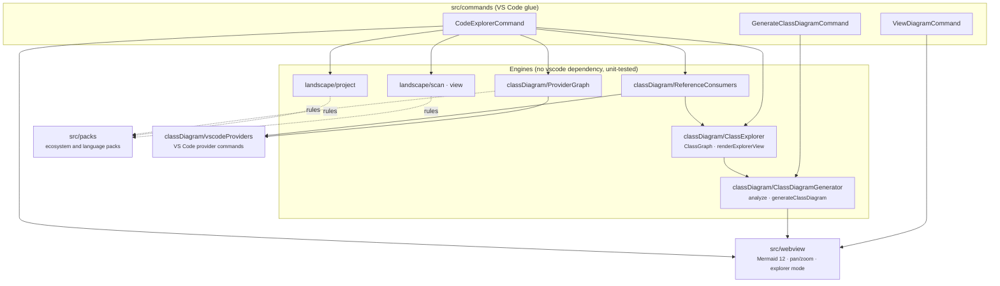
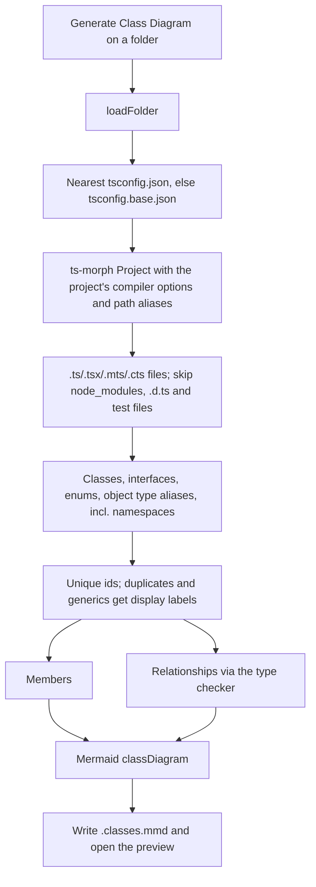

# Architecture

The extension has three features that share one renderer:

| Feature | Entry | Engine | Output |
|---|---|---|---|
| **Mermaid preview** | `ViewDiagramCommand` | Mermaid 12 in a webview | a pan-and-zoom preview of `.mmd` / `.mermaid` files |
| **Class diagrams** (TypeScript) | `GenerateClassDiagramCommand` | `ClassDiagramGenerator` (ts-morph) | `.classes.mmd` files |
| **Code Explorer** | `CodeExplorerCommand` | landscape scanner, project reader, class graphs; language and ecosystem packs | interactive views in one panel |

Everything in "Engines" is free of the `vscode` API, so it runs in plain unit
tests and golden tests; the commands add settings, progress, cancellation and
the panel.

## Mermaid preview

`src/commands/ViewDiagramCommand.ts` opens a webview (`src/webview/`) that
renders the file with Mermaid 12 (ELK layout and the modern look by
default; frontmatter can select the classic style) with pan and zoom. The
webview signals when it is ready before the diagram is sent. In single
preview mode one panel follows the active editor
([preview modes](preview-modes.md)).

## Class diagrams

- **Loading:** the nearest `tsconfig.json` (or a monorepo's
  `tsconfig.base.json`) supplies compiler options and `paths`, so imports
  resolve as in the build; without one, fixed options are used.
- **Members:** types as written (inferred only without an annotation),
  visibility `+` `-` `#`, static `$`, abstract `*`, getters/setters and
  constructor parameter properties, parameters by name.
- **Relationships** come from the type checker, so they work across files
  and aliases and same-named classes stay distinct:

  | Source | Arrow |
  |---|---|
  | `class B extends A`, `interface B extends A` | `A <\|-- B` |
  | `class B implements A` | `A <\|.. B` |
  | field, getter or parameter property of type A (also in arrays, generics, unions) | `B --> A : field` |
  | plain constructor parameter of type A | `B ..> A` |

- **Views:** `detail` (`full`, `public`, `names`), grouping by folder (Mermaid
  namespaces), and `focusFiles` (a file's classes and everything with an
  arrow to or from them). Large folders ask which view to use.

## Code Explorer

One panel (`src/commands/CodeExplorerCommand.ts`) with one history of
steps. Back pops it, Start over re-shows the first step, and the breadcrumb
jumps to any level above. A step is one of:

| Step | Built by | Shows |
|---|---|---|
| `landscape` | `scanFolder()` + `renderLandscapeView()` | the projects in a folder, one level at a time |
| `project` | `readProjectCode()` + `renderProjectView()` | one project's code, a folder at a time |
| `classes` | an `ExplorerGraph` + `renderExplorerView()` | classes lit around a file, growing as you click |

Everything language- or ecosystem-specific comes from packs (`src/packs/`);
the engines never name a language (`src/test/Packs.test.ts` enforces it).
See [language packs](language-packs.md) for the interfaces, diagrams and how
to add a language.

### Repository view: `src/landscape/scan.ts`, `view.ts`

Deterministic by design: every box, label and arrow comes from a rule applied
to the files, never from interpreting scripts or naming conventions.

- `scanFolder()` walks the folder (skipping ignored folders), makes a
  project of every folder with a marker file (ecosystem packs' `markers`),
  assigns each file to its nearest project, reads each project's facts
  (`readProject`: names, dependencies, path references, aliases), and
  resolves references: imports read by the packs' `ImportRule`s, matched
  against declared names (exact, else the longest `/` prefix; the closest
  project wins when several declare a name) or aliases. It also records, per
  file, the imports that reached another project.
- `renderLandscapeView()` draws one level as a Mermaid flowchart: the
  projects one level down (deeper references summed onto them), one dashed
  box for files not in a project, at most 20 arrows. It returns each node's
  click target and the hover text naming its rule.

### Project view: `src/landscape/project.ts`

- `readProjectCode()` takes a project's own files (not those of projects
  nested in it), its declared source roots and entry points, and reads each
  file with its ecosystem's `CodeRule`: imports resolved by path or by
  declared namespace, and entries the language itself marks. Test files'
  imports are skipped unless included.
- `renderProjectView()` draws one folder: subfolders, code files (entries
  first, at most 12), other files, the project's marker files, files and
  folders outside this folder that are imported, and other projects (from
  the scan's per-file references). A folder holding exactly one folder and
  no files is passed through. It opens at the single declared source root
  unless an entry lies outside it.

### Class views: `src/classDiagram/`

- `ClassGraph` (`ClassExplorer.ts`) indexes the TypeScript analysis
  (`analyze()`, cached per project root and dropped when a file under it is
  saved) by direction: **up** (supertypes), **down** (subtypes), **out**
  (used classes), **in** (consumers).
- `ProviderGraph` answers every other language from the installed language
  extension, one click at a time, through `Providers`
  (`vscodeProviders.ts` wraps VS Code's provider commands): document
  symbols for the boxes, type hierarchy (else declaration headers, else
  blocks declared apart) for up and down, type definitions of fields (else
  the names on the declaration line) for out, references for in. Answers
  outside the workspace, in ignored folders or in test files are dropped; a
  failed question counts as no answer. Its rules are listed at the top of
  the file and in [the explorer examples](../test-files/explorer/README.md).
- `WithReferenceConsumers` wraps `ClassGraph` to add consumers from every
  reference (`classDiagram.explorerConsumers: "references"`).
- `renderExplorerView()` draws the lit classes in full, their neighbours as
  dashed boxes labelled with their folder, and a "+N more" box past 8 per
  direction.

The panel is the diagram webview in explorer mode (`src/webview/explorer.ts`),
opened in the main editor area; source files open beside it. Node clicks are
posted back (a drag is not a click), with a progress scene while reading and
the fallback notes in the hint line.

Every render carries a transition, computed by the host from the previous
step and the new one (`CodeExplorerCommand.transition`):

| Kind | When | Webview |
|---|---|---|
| `extend` | a class view grows or shrinks | keeps the zoom, pins the box you were on, glides kept boxes to their new places, new boxes glow |
| `descend` | into a project, folder or file | the old picture zooms into the clicked box |
| `ascend` | Back or a breadcrumb up a level | the reverse zoom |
| `jump` / `start` | anything else | a crossfade |

It also names `focus` (the box you clicked: a solid "you clicked" ring) and
`from` (the box you were on, or the box holding it after going up: a dashed
"came from" ring), and the `level` (Projects, Code, Classes) shown in a badge
by the breadcrumb that flashes when it changes. With reduced motion the
animations are skipped; the rings and badge stay.

### Check Explorer Language Support: `src/probe/languageProbe.ts`

Asks the installed extensions every question the explorer uses for one file
and reports, per direction, whether the extension answers, a pack rule fills
in, or nothing does; the detailed tables are for pack authors. **Record
Explorer Answers** (`src/probe/recordAnswers.ts`) saves the answers for a
test example.

## Testing

The suites run inside a VS Code test host (`npm test`), except the explorer
panel test, which runs in a browser.

- **Class diagram goldens** (`test-files/class-diagram/`): small TypeScript
  projects with the diagrams they should produce.
- **Landscape and project view goldens** (`test-files/landscape/`): a made-up
  repository with projects in every supported ecosystem, and the expected
  repository and project views.
- **Explorer goldens** (`test-files/explorer/`): the same orders example in
  seven languages, the walks to take (`views.json`), each language
  extension's recorded answers (`answers.json`) and the expected views. Tests
  replay the recordings, so CI needs no language server; a question missing
  from a recording fails the test. TypeScript is also rendered from our own
  analysis to compare.
- **Unit tests:** the generator, pack readers (TOML, imports per language,
  entries), pack rules, and the packs' plug-in contract.
- **Language extension adapter** (`VscodeProviders.test.ts`): a fake
  language extension answers in every shape VS Code allows; the live adapter
  must turn each into the answers the recordings hold.
- **Explorer panel** (`test-webview/`, `npm run test:webview`): the built
  webview (`npm run build`) in headless Chromium, driven with the extension's
  messages: the level badge, the "you clicked" and "came from" rings, the
  clicked box kept on screen, reduced motion, and clicks posted back (a drag is
  not a click). Uses Playwright's Chromium if installed, else the system
  Chrome.

On a golden mismatch the actual output is written next to the expected file;
`UPDATE_GOLDENS=1` accepts it.

## Performance

- The repository scan reads only marker files and import lines: about 1–2 s for
  a 50-project, 6-language repository.
- A project view reads its own files once (cached until a file under it is
  saved): about 0.4 s for a 3,700-file Angular app.
- TypeScript class analysis: about 1.5 to 4.5 s for 450 files; it yields
  between files so progress and Cancel stay responsive.
- Language extensions are asked one click at a time; at most 50 files of
  references are resolved per class.
