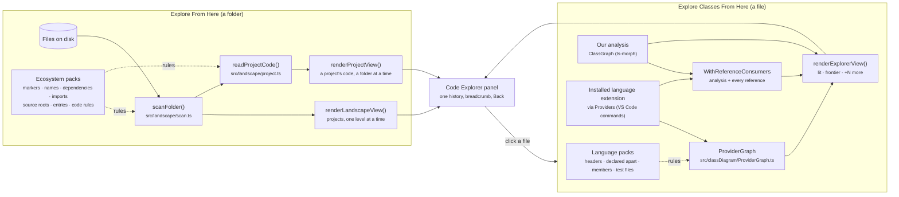
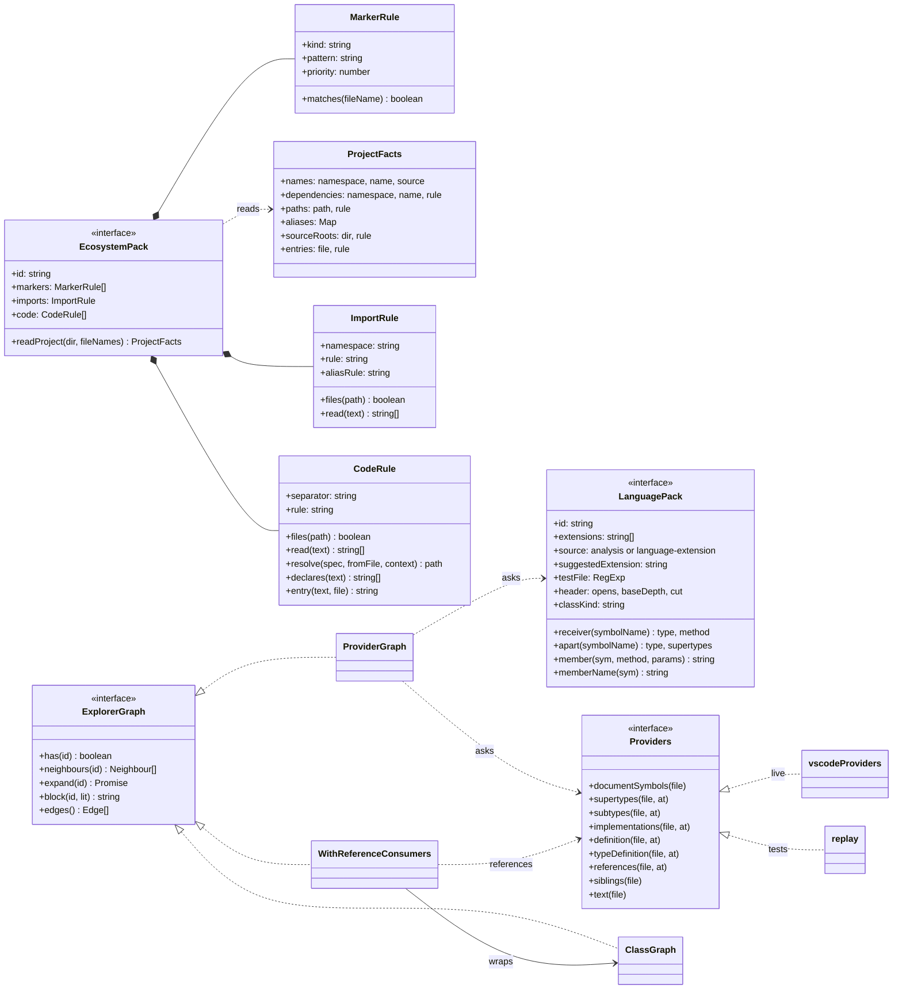
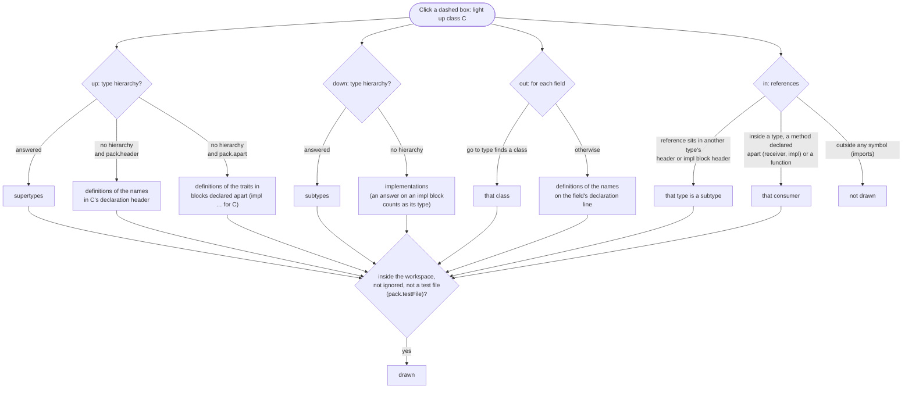
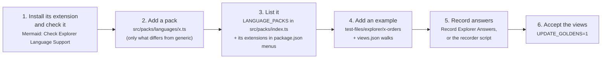

# Language and ecosystem packs

The explorer visualizes any language and any kind of project the same way.
Everything that differs between languages lives in a **pack**: a small file of
fixed rules. The engines that build the views never name a language; they ask
packs. A test (`src/test/Packs.test.ts`) fails if an engine mentions one.

**The principle:** a feature is written once, in an engine, for every
language. A pack only says how its language *spells* things: which file marks
a project, how an import names another file, where a class's base list ends,
how a method declared apart from its type names that type. When a feature
works for one language, it works for all of them, as far as each pack and
language extension can answer.

There are two kinds of pack:

| Pack | Views | Answers |
|---|---|---|
| **Ecosystem pack** (`src/packs/ecosystems/`) | Explore From Here: the repository and project views | Which folders are projects, what they are called, which other projects they declare they use; inside a project, its source roots, entry points and the imports between its files |
| **Language pack** (`src/packs/languages/`) | Explore Classes From Here | How to read a file's classes, members, supertypes, subtypes, field types and consumers from the language extension's answers |

## How the pieces fit

The panel walks one history: repository → project → folder → file → classes.

The class explorer has one view and three interchangeable sources behind the
`ExplorerGraph` interface. A language pack's `source` picks one:

- `analysis`: our own TypeScript analysis (TypeScript only). With
  `classDiagram.explorerConsumers: "references"` it is wrapped to add
  consumers from the language extension.
- `language-extension`: `ProviderGraph`, answered by whatever extension is
  installed for the language (Go, C#, PHP, Python, Java, Rust and the rest).

## The interfaces

- `ImportRule` resolves imports **between projects** (by declared name, or by
  alias) for the repository view.
- `CodeRule` resolves imports **between files of one project** for the
  project view, in one of two ways:
  - **by path:** `resolve` returns the file or folder a specifier names
    (TypeScript relative imports and aliases, Go module paths, Python modules,
    Rust `mod` and `use crate::`, PHP `require` of a literal path);
  - **by declared namespace:** `declares` lists the namespaces a file
    declares, and an import names one (C# `using`, PHP `use`, Java and
    Kotlin `import`). The longest declared prefix wins; a following name that
    matches a file picks that file.

  `entry` marks files the language itself makes program entries.
- `Providers` is the seam to language extensions: `vscodeProviders()` asks VS
  Code's provider commands (and so whichever extension is installed); the
  tests replay recorded answers instead, so CI needs no language server.

## One click, any language

Lighting up a class asks the language extension the same questions for every
language. Where an extension cannot answer, a universal fallback takes over,
switched on by pack data, never by language name:

Answers for up, down and out count only where they land on a type's name (or
an impl block of it); references count by the innermost symbol around them.
A type's members are its direct children of kind field, property, enum
member, variable or constant (Python attributes are variables), and its
methods, including those declared apart. The panel says when a fallback
answered.

## Declared apart

Some languages declare a type's methods, or the supertypes it implements,
outside its body. Packs describe how such a symbol names its type; the engine
attaches them to the type, looking across the file's folder:

| Language | Symbol | Pack field | Gives |
|---|---|---|---|
| Go | method `(*MemStore).Save` | `receiver` | method `Save` of `MemStore` |
| Rust | block `impl Order` | `apart` | its methods belong to `Order` |
| Rust | block `impl Store for MemStore` | `apart` | its methods belong to `MemStore`; `MemStore` implements `Store` |

Swift `extension Type: Protocol` and similar constructs fit the same field.

## What each pack says today

| Language pack | Source | Pack-specific rules | Checked with |
|---|---|---|---|
| `typescript` | our analysis | test files `*.spec.ts`/`*.test.ts`; header `{` | built-in extension, three ways (`test-files/explorer/ts-orders`) |
| `go` | language extension | receivers `(*T).M` attach to `T` in the folder; exported = capitalised; `func(…)` signatures; no headers; `_test.go`; other named types are "type" | `golang.go` + gopls (`go-orders`) |
| `csharp` | language extension | header `{`, a `where` clause is not a base | `ms-dotnettools.csharp` (`csharp-orders`) |
| `php` | language extension | header `{` | Intelephense (`php-orders`) |
| `python` | language extension | header `:`, bases inside `( )`; `test_*.py`, `*_test.py`; `__x` private, `_x` internal | Pylance (`python-orders`) |
| `java` | language extension | Java and Kotlin; header `{`; test classes `Test*`, `*Test`, `*Tests`, `*TestCase` (Maven Surefire's defaults) | `redhat.java` (`java-orders`) |
| `rust` | language extension | `impl [Trait for] Type` blocks declared apart; supertraits in `trait A: B {`; a `where` clause is not a base; `fn(…)` signatures without the receiver | rust-analyzer (`rust-orders`) |
| `ruby` | language extension | header ends at the line's end (`class A < B`) | not yet recorded |
| `generic` | language extension | header `{`; Swift, Scala, Dart, C/C++, and the fallback for any other file | not yet recorded |

Member lines use shared rules (`src/packs/languages/members.ts`): a name
`Name(params) : Type` is split (C#), a detail that is only a visibility
keyword becomes `-` `#` `~` `+` (PHP), parameters come from child symbols
before the body when the name has none (PHP).

| Ecosystem pack | Markers | Names (namespace) | Declared references | Project view: roots, entries, imports |
|---|---|---|---|---|
| `javascript` | `nx.json`, `angular.json`, `package.json`, `project.json`, `tsconfig.json` | `package.json` name (npm) | `package.json` dependencies; imports of package names; imports of tsconfig `paths` aliases | `sourceRoot` (angular.json, project.json); build targets' `main`/`browser`/`server`, `package.json` `main`/`module`/`bin`/`exports`; relative imports and aliases |
| `composer` | `composer.json` | `composer.json` name (composer) | `require` | `autoload.psr-4` folders; `bin`; `use` by namespace, `require` of a literal path |
| `go` | `go.work`, `go.mod` | module path (go) | `require`; local `replace`; imports inside a module path | imports inside the module (package folders); `package main` with `func main` |
| `dotnet` | `*.sln`, `*.csproj` | – | `<ProjectReference>` | `using` by declared namespace; `static Main` or top-level statements |
| `python` | `pyproject.toml`, `requirements.txt`, `setup.py` | `pyproject.toml` name (pypi, PEP 503) | `pyproject.toml` and `requirements.txt` dependencies; Poetry path dependencies | `tool.setuptools.package-dir`, `src/`; `[project.scripts]`, `__main__`; relative and absolute imports |
| `jvm` | `pom.xml`, `build.gradle(.kts)`, `settings.gradle(.kts)` | `groupId:artifactId` (maven) | `pom.xml` dependencies | `sourceDirectory` or the standard layout; `main` methods; `import` by declared package |
| `cargo` | `Cargo.toml` | package name (crates) | dependencies, path dependencies, `use` of a crate | crate root; Cargo targets; `mod`, `use crate::`/`super::`/`self::` |
| `markers` | `Dockerfile`, `Jenkinsfile`, `*.tf` | – | – (recognised only) | – |

The engine resolves names the same way for every namespace: exact, else the
longest `/` prefix (deep imports, Go packages); when several projects declare
a name, the closest to the referencing project wins.

## Adding a language

1. **Check** a file of the language: which questions does its extension
   answer, and which fallbacks would fill in?
2. **Pack:** start from `generic`; add only what the check and the language
   show is different (where the body opens, methods declared apart, test
   files, how members read).
3. **List** it; the packs test fails until its extensions are in the menus.
4. **Example:** the same orders example (an entity base, a store interface
   and implementation, a service) keeps languages comparable.
5. **Record** in the Extension Development Host (open the example folder
   itself, so the extension loads it as a project), or drive a language
   server directly:
   `node scripts/record-provider-answers.js test-files/explorer/x-orders.views -- <server command>`.
6. **Accept** the views and read them: every arrow should be explainable by a
   rule above. If a rule is missing, write it once in the engine, switched on
   by pack data, and check the other languages' views stay the same.

Adding an ecosystem is the same: a file in `src/packs/ecosystems/` with its
markers (with a label priority), `readProject` for names, declared
dependencies, source roots and entries, `imports` if its source files
reference other projects, and `code` for imports between its files; list it
in `ECOSYSTEM_PACKS`, and add a project to `test-files/landscape/acme`.
